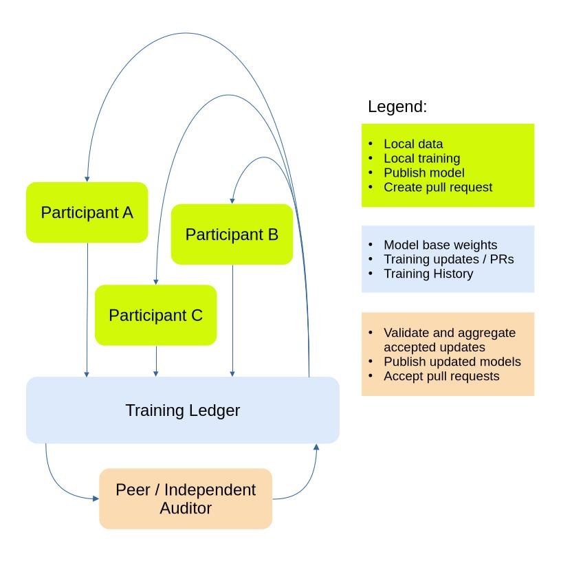

# Training Process

The training process is hardware-agnostic, parallel, and completely asynchronous. 

Model weights are available throughout the entire training process. Both the global model weights and the submitted log transitions are fully observable. Model weights are versioned and tracked in a central, publicly accessible Git repository: [Training Ledger](https://huggingface.co/goodwoolf/goodwoolf-ledger).

Because nodes train independently, a Pull Request may be submitted based on an older version of the global weights. Rather than discarding this work, the validation pipeline calculates the update's staleness relative to the current live base model. It applies an attenuation penalty (&alpha;) to the update's delta during the evaluation or merging process, ensuring that heavily out-of-date updates do not disrupt recent optimizations.

The decentralized training workflow is illustrated visually **(A)** and in pseudocode **(B)** below. Participants repeatedly pull weights from the training ledger, train independently, and submit updates back to it. To complete the training cycle, other peers validatate the new updates and submit merged models back to the training ledger.

### A) Visual represenation of Decentralized Training Workflow



### B) Pseudocode represenation of Decentralized Training Workflow

```text
// model          = Python model implementation
// global_ledger  = Central Training Log tracking sequential model versions
// benchmark_data = Standardized, held-out evaluation dataset
// alpha_base     = Base mixing hyperparameter / learning rate dampener

================================================================================
USER WORKFLOW (Runs on Participant Training Nodes)
================================================================================
while training_is_active:
    // 1. Fetch the absolute latest verified base model from the ledger
    (base_weights, v_base) = retrieve_latest_base_model(global_ledger)

    // 2. Train locally on independent data (GoodWoolf is agnostic to this step)
    trained_weights = train_local_workload(base_weights, local_data)

    // 3. Submit the newly trained model to the network as a Pull Request
    submit_pull_request(global_ledger, parent_version=v_base, proposed_weights=trained_weights)


================================================================================
VALIDATION & MERGE WORKFLOW (Runs via Network Peers / Auditors)
================================================================================
while active_prs_exist:
    // 1. Grab the next pending update proposal from the queue
    pr = fetch_next_pending_pr(global_ledger)
    
    // 2. Check the current state of the global ledger right now
    (current_weights, v_current) = retrieve_latest_base_model(global_ledger)

    // 3. Calculate staleness relative to the current state
    staleness = v_current - pr.parent_version
    attenuation = 1.0 / (1.0 + staleness)

    // 4. Isolate the proposed update delta and apply the attenuation penalty
    delta_local = pr.proposed_weights - pr.base_weights_at_v_base
    attenuated_weights = current_weights + (alpha_base * attenuation * delta_local)

    // 5. Evaluate the attenuated weights against the benchmark metrics
    metrics_passed = evaluate_on_benchmark(attenuated_weights, benchmark_data)

    if metrics_passed:
        // 6. Securely merge the weights. This automatically becomes the new base model.
        merge_to_base(global_ledger, attenuated_weights)
        broadcast_new_base_version()
    else:
        // 7. Reject the proposal if it fails to improve the model or introduces regression
        reject_pr(global_ledger, pr)
```
